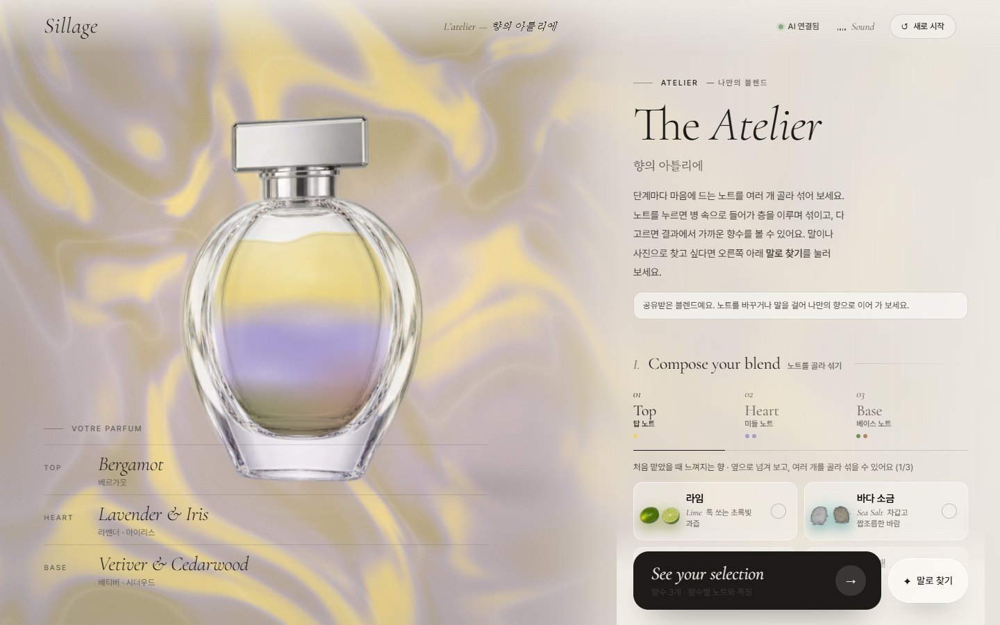
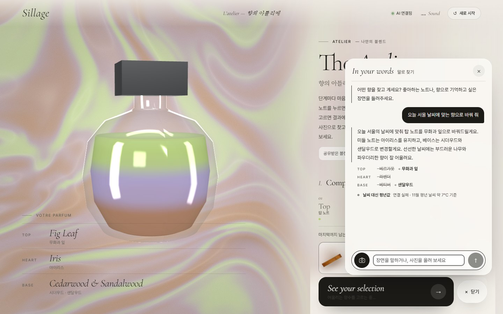
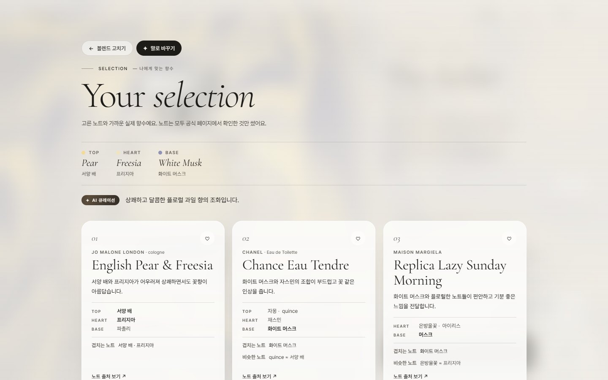
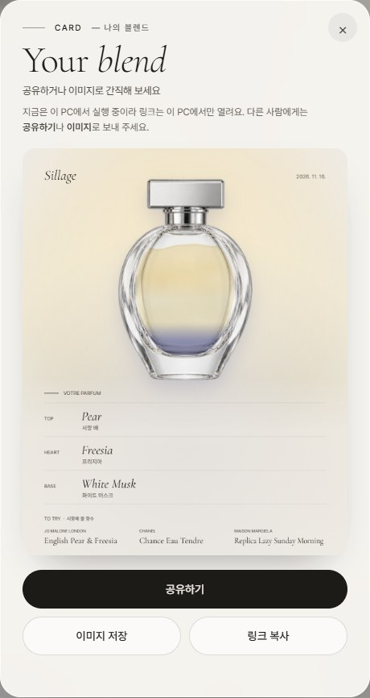

# Sillage · 향의 아틀리에

> 향이 지나간 자리에 남는 것 — *The trace a scent leaves*

향을 잘 몰라도 노트를 골라 섞거나, 장면을 말하거나, 사진을 올리면
**병 속 액체와 배경의 색이 함께 바뀌고**, 실제로 노트가 겹치는 시판 향수를 근거와 함께 추천하는 교육용 웹 서비스입니다.


## 3분 시연 순서

1. **첫 화면에서 스크롤**: 노트란? → 탑·미들·베이스 → 계열 → 향료 → 농도 → 시향법. 배경색이 장을 따라 부드럽게 이어져요. 끝에서 *Find your scent*.
2. **상담 화면**에서 예시 버튼 **"오늘 서울 날씨에 맞는 향"** → AI가 MCP 날씨 도구로 실제 기온을 확인하고 노트를 바꿔요. 대화 아래에 '오늘 날씨 확인 · 서울 ○°C'처럼 확인한 정보가 남아요.
3. **"탐다오 같은 향으로 만들어 줘"** → 향수 DB에서 공식 노트를 찾아 같은 노트로 블렌드를 채우고, 우리 목록에 없는 노트는 가장 가까운 노트로 옮겨요(예: 유자 ≈ 자몽). 아래 추천 맨 앞에 그 향수가 *기준 향수*로 나와요. 아래 *AI 큐레이션*에 검증된 향수 3개와 겹치는 노트가 나와요.
4. 추천 카드의 **♡**로 저장 → **✦ 결과 카드 만들기** → 카드 보기, 공유하기·이미지 저장·링크 복사.

| 상담 화면 | MCP 도구를 쓰는 대화 |
| --- | --- |
|  |  |
| **AI 큐레이션 (RAG)** | **결과 카드** |
|  |  |

## 주요 기능

| 기능 | 설명 |
| --- | --- |
| 스크롤 스토리 | 노트란? → 탑·미들·베이스 → 향의 계열 → 향료 → 농도 → 시향하는 법을 순서대로 배워요. 스크롤에 맞춰 글과 병, 배경 색이 움직여요. |
| 노트 블렌딩 | 탑 13·미들 11·베이스 11, 총 35개 노트(실사 재료 사진)에서 단계마다 최대 3개를 골라 섞어요. 색은 OKLab 공간에서 섞여 병 속에 층을 이뤄요. |
| AI 큐레이션 (RAG) | 실제 상품 페이지에서 검증한 향수 55종 DB에서 노트가 겹치는 후보를 찾고, LLM이 그 후보 안에서만 3개를 골라 이유를 써요. 겹치는 노트는 코드가 계산해요. |
| 대화로 노트 바꾸기 | "너무 달아요, 비 온 뒤 숲처럼"이라고 말하면 LLM이 지금 선택을 짚고 노트를 직접 바꿔요. 실제 변경은 −/+ 표시로 보여 줘요. "달지 않게" 같은 바람은 AI 큐레이션에도 그대로 넘어가 단 향수(바닐라·통카·꿀 등)를 뺀 추천이 나와요. |
| MCP 도구 | 상담 LLM이 **MCP 서버**(`mcp_server.py`)의 도구를 불러 실제 정보를 확인해요. 오늘 날씨에 맞는 향(Open-Meteo), "탐다오 같은 향으로"(향수 DB에서 실제 노트를 찾아 블렌드를 채움), 두 향수 비교, 노트 설명. 확인한 내용은 대화 아래에 '오늘 날씨 확인', '향수 노트 확인'처럼 쉬운 말로 남아요(마우스를 올리면 MCP 도구로 확인했다고 나와요). 후보를 찾는 내부 DB 검색은 화면에 보이지 않아요. 키가 없는 체험 모드에서도 날씨와 향수 조회는 같은 MCP 도구로 동작해요. |
| 저장한 향수 | 추천 카드의 ♡로 마음에 든 향수를 저장해요(이 브라우저에만 보관). 상담과 AI 큐레이션이 저장한 취향을 참고하고, '이 향처럼 블렌드'로 바로 따라 만들 수 있어요. |
| 결과 카드 | 지금 병 속의 층진 액체 그대로 병을 담고, 아래에 탑·미들·베이스와 시향해 볼 향수를 적은 카드를 화면에 띄워요. 공유하기(휴대폰 공유 창), 이미지 저장(PNG, `sillage_탑-미들-베이스_날짜.png` 이름으로 저장되고 Chrome·Edge에서는 저장 위치를 고르는 창이 떠요), 링크 복사를 고를 수 있어요. 카드는 브라우저에서 그리고 서버로 보내지 않아요. |
| 공유 링크 | `?top=bergamot&heart=lavender,iris&base=vetiver&bottle=oval`처럼 블렌드와 병이 주소에 담겨요. 링크를 열면 스토리를 건너뛰고 같은 병·블렌드·추천이 바로 열려요. 서버에 아무것도 저장하지 않아요. 지금은 로컬 실행이라 같은 PC에서만 열리고, 사이트를 배포하면 그대로 다른 사람과 공유하는 링크가 돼요. |
| 사진으로 향 찾기 | 사진을 올리면 장면의 색, 빛, 계절을 읽어 노트를 골라요. 사진은 저장하지 않아요. |
| 효과음 | 실제 녹음한 유리잔, 크리스털, 물소리. 기본은 꺼짐이고 오른쪽 위 *Sound* 버튼으로 켜요. |

## 바로 실행하기 (Windows)

**Python 3.10 이상**만 있으면 됩니다. 화면은 이미 빌드되어 `dist/`에 들어 있어요.

1. 폴더 안의 **`실행.bat`**을 더블클릭해요. 처음 한 번은 필요한 패키지를 설치하느라 1~2분 걸려요.
2. 브라우저에서 **http://127.0.0.1:8765** 가 열려요.

직접 실행하려면 아래 명령을 차례로 입력해요.

```powershell
python -m venv .venv
.\.venv\Scripts\python.exe -m pip install -r requirements.txt
.\.venv\Scripts\python.exe -m uvicorn server:app --host 127.0.0.1 --port 8765
```

macOS·Linux에서는 `sh run.sh`를 실행해요.

## OpenAI API 키 (선택)

키가 없어도 **체험 모드**로 화면, 노트 블렌딩, 규칙 기반 추천, MCP 날씨·향수 조회가 모두 동작해요. LLM 상담, AI 큐레이션, 사진 분석을 쓰려면 둘 중 하나를 해요.

- **화면에서 입력 (간편)**: 상담 화면 오른쪽 위 **체험 모드** 또는 대화창 아래 **AI 키 넣기** 버튼 → OpenAI 키(`sk-...`) 입력 → 저장. 키는 그 브라우저 탭에만 보관되고, 탭을 닫으면 지워져요. 서버는 키를 저장하거나 기록하지 않고 OpenAI 호출에만 써요.
- **`.env` 파일**: `.env.example`을 `.env`로 복사하고 `LLM_API_KEY`를 채운 뒤 서버를 다시 켜요.

사용 모델은 `gpt-4o-mini`(Responses API)와 `text-embedding-3-small`이에요. 한 번 상담할 때 드는 비용은 1센트에도 한참 못 미쳐요.

## 동작 원리

```
[브라우저 React]  노트 선택 · 대화 · 사진
       │
       ▼
[FastAPI server.py]
  ├─ /api/blend      규칙 점수로 즉시 추천
  ├─ /api/recommend  RAG: rag.py가 노트 겹침(단계 가중) + 계열 + 임베딩 유사도로 후보 8개
  │                  → gpt-4o-mini가 후보 id 안에서만 3개 선택 + 이유(JSON 스키마 enum으로 강제)
  └─ /api/chat       대화·사진 → gpt-4o-mini가 필요하면 MCP 도구를 부르고(최대 3번)
                     → 노트 변경(changes)을 구조화 출력 → 서버가 적용
       │   MCP 클라이언트 (mcp 2.x, 같은 프로세스 안에서 연결)
       ▼
[mcp_server.py]  MCP 서버 — search_perfumes · find_perfume · describe_note · get_weather
       │
       ▼
[data/perfumes.json]  검증된 향수 55종 (노트마다 출처 URL)   ·   Open-Meteo 날씨 API (키 없음)
```

날씨 서비스에 연결하지 못하면(인터넷이 막힌 환경 등) 서울의 이달 평년 기온으로 대신 고르고, 답변과 확인한 정보에 "평년값 기준"이라고 알려요.

**같은 노트와 비슷한 노트.** 향수 55종의 공식 노트 320개 중 우리 35개 노트와 똑같은 것은 205개(약 64%)예요. 나머지는 `rag.py`의 '가까운 노트' 사전으로 가장 비슷한 우리 노트에 이어요(유자 ≈ 자몽, 정향 ≈ 카다멈, 주니퍼 ≈ 사이프러스, 망고 ≈ 서양 배 등, 남은 것은 체리 2개뿐). 비슷한 노트는 추천 점수에서 같은 노트보다 낮게 치고, 화면과 답변에서 '비슷한 노트 · 원래 노트 ≈ 우리 노트'로 구분해 보여 줘요.

LLM이 노트를 지어내지 않도록, 사실은 코드가 확인해요.
- "○○ 같은 향"이면 서버가 그 향수의 실제 노트로 블렌드를 채우고, 답변도 그 결과대로 써요.
- 날씨를 확인했는데 빈 단계가 있으면 날씨에 맞는 노트로 채워요.
- "달지 않게"는 사용자가 실제로 그렇게 말했을 때만 켜져요(LLM이 취향을 지어내는 것을 막음).

## MCP 서버 따로 쓰기

`mcp_server.py`는 표준 MCP(stdio) 서버라서 Claude Desktop, Claude Code 같은 MCP 클라이언트에 그대로 연결할 수 있어요.

```json
{
  "mcpServers": {
    "sillage": {
      "command": "C:/경로/Sillage/.venv/Scripts/python.exe",
      "args": ["C:/경로/Sillage/mcp_server.py"]
    }
  }
}
```

| 도구 | 하는 일 |
| --- | --- |
| `search_perfumes(notes, avoid_sweet, family, limit)` | 노트 조합과 겹치는 향수를 검증된 DB에서 찾아요. |
| `find_perfume(name)` | 향수 이름(영어 또는 '탐다오' 같은 한국어 통칭)으로 실제 노트 피라미드와 그에 해당하는 우리 노트를 돌려줘요. |
| `describe_note(note)` | 노트의 느낌, 계열, 그 노트가 들어간 향수를 알려 줘요. |
| `get_weather(city)` | Open-Meteo로 현재 날씨를 받아 어울리는 향의 방향과 노트를 제안해요. |

**향수 DB를 만든 방법** (`scripts/build_catalog.py`)
1. 웹 검색으로 각 향수의 공식(또는 대형 판매처) 상품 페이지를 찾아요.
2. 페이지를 직접 내려받아 **본문에서만** 노트를 추출해요.
3. 추출된 노트가 원문에 실제로 있는지 코드로 다시 대조하고, 없는 노트는 버려요.

봇 차단으로 받을 수 없는 페이지는 브라우저로 노트 부분을 저장해(`data/pages/`) 같은 검증을 거쳤어요. LLM만으로 추천하면 실제와 다른 노트를 지어내는 문제가 있어서 이렇게 설계했어요.

## 폴더 구조

```
server.py            FastAPI 서버 (API + 빌드된 화면 제공, MCP 클라이언트)
mcp_server.py        MCP 서버 (향수 검색·조회, 노트 설명, 날씨 도구)
rag.py               향수 검색: 노트 사전, 점수, 임베딩
blend-notes.json     노트 35개 (이름, 느낌, 색, 계열)
data/perfumes.json   검증된 향수 55종
data/pages/          브라우저로 저장한 원문 조각 (검증 입력)
src/                 React 화면 (main.jsx, 셰이더 배경, 액체, 효과음)
tests/               pytest (MCP 도구, 추천, API)
docs/screens/        README 화면 캡처
public/notes/        노트 재료 사진 (배경 제거 webp)
public/sounds/       효과음
scripts/             DB 구축, 노트 사진 수집·배경 제거 스크립트
dist/                빌드된 화면 (npm run build 결과)
```

화면을 수정하려면 Node.js 20 이상에서 `npm ci` 후 `npm run build`를 실행해요.

## 테스트

```powershell
.\.venv\Scripts\python.exe -m pip install -r requirements-dev.txt
.\.venv\Scripts\python.exe -m pytest -q tests
```

OpenAI 키와 인터넷 없이 돌아가요(32개). 확인하는 것:
- MCP 서버의 도구 4개를 MCP 클라이언트로 실제 호출(목록, 향수 조회, 검색, 노트 설명, 날씨)
- **지어낸 노트가 없는지**: 55종 모두에 대해 '○○ 같은 향'으로 옮긴 노트가 그 향수의 검증된 노트 안에만 있는지
- '달지 않게'를 켜면 단 향수가 추천에서 빠지는지, 겹친 노트가 사용자가 고른 노트뿐인지
- 날씨 서비스가 끊겼을 때 평년값으로 대신 답하는지
- 체험 모드 API(향수 따라 만들기, 비교, 단계가 틀린 노트 거절, 직접 바꾼 노트를 답변이 그대로 말하는지), webp 이미지 형식
- **AI 대화 경로**(OpenAI 대신 가짜 응답): AI가 사실과 다른 말을 하거나 단맛 회피를 지어내도 서버가 바로잡는지, 빈 단계 채우기, 단계가 틀린 노트 옮기기, 이상한 형식의 응답에도 멈추지 않는지
- '달라서', '이번 달'을 단맛 회피로 착각하지 않는지, '휠체어'를 향수 Hwyl로 착각하지 않는지

## 자료 출처와 라이선스

- **노트 재료 사진 35장**: Wikimedia Commons (CC0, 퍼블릭 도메인, CC BY, CC BY-SA, GFDL — 카다멈 1장). 아이리스, 통카 빈, 무화과 잎, 바다 소금, 프리지아는 실제 재료에 더 가까운 사진으로 바꿨고, 레몬·생강·블랙커런트·작약·담배잎을 새로 더했어요. 배경 제거, 자르기, 크기 조정을 했어요. 사진별 저작자와 라이선스는 `public/notes/CREDITS.json`과 상담 화면 맨 아래 '재료 사진 출처'에서 볼 수 있어요.
- **효과음 4개**: Freesound, 모두 CC0 1.0. 목록은 `public/sounds/CREDITS.json`에 있어요.
- **향수 노트 정보**: 각 브랜드 공식 사이트와 판매처 상품 페이지. 향수마다 출처 URL을 `data/perfumes.json`의 `source`에 남겼어요. 브랜드명과 향수명은 각 브랜드의 상표예요.
- **폰트**: Cormorant Garamond, Noto Serif KR (Google Fonts, OFL), Pretendard (OFL).
- **날씨**: Open-Meteo (키 필요 없음, CC BY 4.0).
- **라이브러리**: React, Vite, GSAP, Lenis, lottie-web, Meta Astryx(입력창·버튼), FastAPI, MCP Python SDK.

## 알려진 한계

- 일부 향수(조말론, 메종 마르지엘라, 디올 등)는 공식 페이지에 대표 노트 2~3개만 공개되어 있어 DB에도 그만큼만 있어요.
- 노트를 판단하는 질은 gpt-4o-mini 수준이에요. LLM이 답변에서 노트의 단계를 잘못 말할 때가 있지만, 실제 적용은 올바른 단계로 되고 화면의 −/+ 표시가 정확한 결과를 보여 줘요.
- 시향 추천은 노트 겹침을 기준으로 한 참고용이에요. 실제 향은 피부와 환경에 따라 달라요.
